layout: default
title: Anime Coloring Pages: Make Your Own Printable Line Art With AI

# Anime Coloring Pages: Make Your Own Printable Line Art With AI
You want **anime coloring pages**, but the free ones online are the same designs over and over, and AI line art often prints with gray smudges or lines that don’t close. 

In this article, I tested two approaches to creating anime coloring pages: generating line art from prompts (Route A) and converting existing illustrations (Route B) with [PixAI](https://eap.pixai.art/go/evelyn).
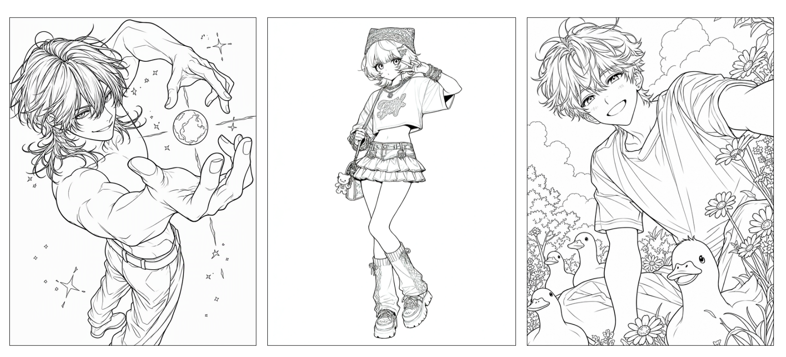

## What Makes a Good Coloring Page
Good-looking outlines don’t always make good anime coloring pages. Make sure your pages have: 

- Black outlines on a pure white background
- No gray shading, gradients, screentone, or hatching
- Clearly defined coloring areas, with closed outlines where needed for bucket filling
- Lines thick enough to stay visible when printed
- Details large enough to color easily

Consider your intended audience. Simple shapes and larger areas work well for kids, while more detailed designs may suit adults. 

## Step 1 — Route A: Generate Line Art From a Prompt
Different line art styles affect how thick and consistent the outlines will be. We’ll test four creative goals: two simple line art designs and two detailed ones. 

Let’s set up our canvas to start:  

1. Go to the PixAI image generator page. Click **Generate** on the home page for a clean canvas:

2. Choose the [Tsubaki.3](https://eap.pixai.art/go/evelyn2) model. Select it under Model Selection or Quick Select:
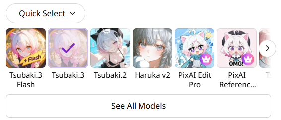
3. Open Settings and choose your preferred Generation Speed, Number of Images, and Resolution. For the aspect ratio, pick based on your desired page size. I’ll use a 3:4 portrait, which is close to A4 paper size. Here are my Settings
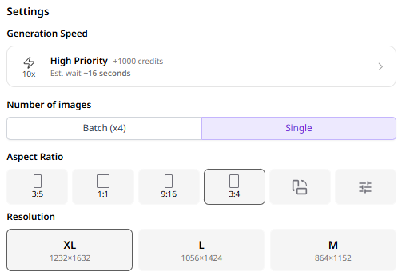
4. Use the [Tsubaki.3 Prompt Guide](https://blog.pixai.art/en/tsubaki-3-prompt-guide/) for additional ideas, or my tested prompts below. Replace the character and scene details, then paste the prompts into the main and Advanced (negative prompt) boxes.

### Two Simple Line Art Coloring Pages
For our simple coloring pages, we’ll make a cute chibi and a full-body OC. I’ll use the same model and settings that I set up earlier consistently. 
1. **Chibi Character**
   
Here’s my prompt:

*"Black-and-white chibi coloring page of a cute girl with long twin tails, a frilly dress, and hair accessories. Full body, one leg bent, holding a daisy, with large flowers and sparkles. Bold, even, closed outlines, large coloring areas, and pure white background. No color, shading, or gray tones."*

Negative prompt:
color, gray, shading, gradient, screentone, hatching, shadow, text, watermark, signature, frame

What I got:
 

I added the border manually to show the image size. PixAI only adds one when prompted. The chibi OC includes all requested details, with even, closed outlines for a clean coloring page.

Keep this negative prompt unchanged for all four Route A pages. (I only adjusted it later, when fixing a page in Step 3.)

**2. Full-body OC**

I kept the same prompt structure but changed the character, pose, and outfit descriptions. I also removed the larger shapes instruction and added the [椿](https://pixai.art/model/2077503995142358039/2077503995675034663) LoRA (an optional community LoRA on PixAI) at 0.7 strength to guide the OC’s face.

Prompt: 

*"Black-and-white anime coloring page of a full-body girl with fluffy short hair, patterned beanie, oversized cropped top, layered skirt, leg warmers, platform shoes, and charm-decorated bag. Stylish crossed-leg pose, holding her bag strap and making a peace sign. Bold, even, closed outlines, large coloring areas, and pure white background. No color, shading, or gray tones."* 

What I got: 
 

Nice! Even with the added LoRA, it didn’t compromise how thick the outlines are. Despite the descriptive outfit, there are no open lines or gray shading observed.

### Two Detailed Line Art Pages
Let’s try something more detailed!

**1. Character with A Pet**

I kept the same prompt structure but added more outfit and pose details, along with a wolf companion. 

Prompt: 

*"Black-and-white anime coloring page of a wolf-eared female warrior with messy hair, armor, fur mantle, and a sword on her back. She rides a massive, muscular direwolf with thick fur and a leather harness. Dynamic three-quarter view, full body, centered. Bold, even, closed black outlines, large coloring areas, and pure white background. No color, shading, or gray tones."*

The result:
.png?raw=true)

The generated image has thinner lines this time, but despite that, there are no open or broken lines. We’re still able to recognize each element and the characters.

**2. Fantasy Character**

Fantasy characters often have intricate outfits and props. Can we still get clean, clear outlines with all those details?

Prompt:

*"Black-and-white anime coloring page of an elegant elf musician with braided hair, pointed ears, and an elaborate off-shoulder outfit with flowing sleeves, layered skirt, gemstones, ribbons, and boots. Gracefully playing a fantasy lute, full body, centered. Bold, even, closed outlines, large coloring areas, and pure white background. No color, shading, or gray tones."* 

Result:
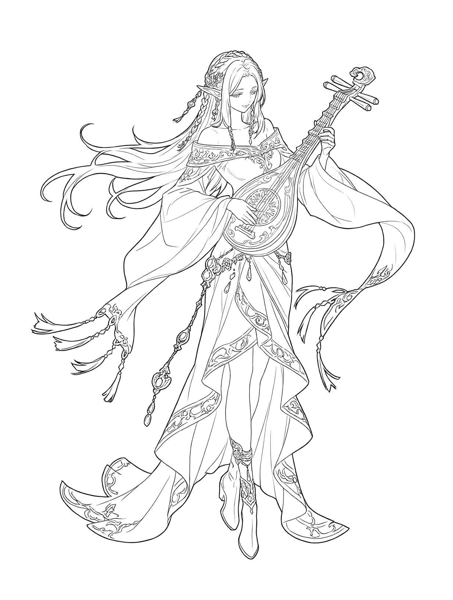

The character, outfit, and prop were preserved, but the thin lines make facial details hard to color. The outlines are closed, though thicker lines would help. Let’s fix this later.

## Step 2 — Route B: Turn Your Own OC Illustration Into a Coloring Page
To turn existing illustrations into coloring pages, I used PixAI Edit Pro. We’ll test four images: two simple and two detailed illustrations.

Let’s use the same editing prompt for all four:

*"Use the uploaded image as the sole reference. Convert it into clean black-and-white coloring line art while preserving the exact character, details, pose, proportions, and composition. Use crisp, smooth outlines with consistent weight and enclosed coloring areas. Pure white background, no color, shading, grayscale, or solid black areas. Add or remove nothing."* 

### Two Simple Illustrations

**1. Furry Character**

To start, I set up our model and settings: 

1. I opened my canvas, clicked **+ Create a new image** to open another one. In the Model selection, I selected [PixAI Edit Pro](https://eap.pixai.art/go/evelyn3).

2. In the settings I set my Resolution and Quality, then choose an aspect ratio suited for coloring pages. I’ll stick with the 3:4 portrait. Here are my other settings:

4. Once done, I headed to the prompt box and uploaded my image reference. Click the image uploader icon and choose or upload your illustration.
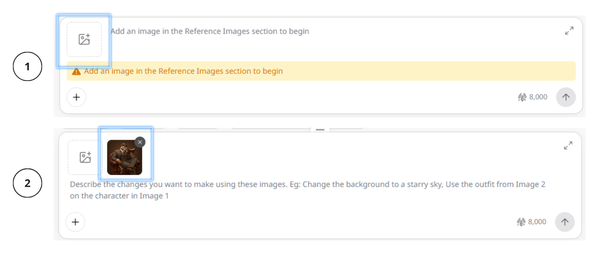

Paste our prompt into the prompt box: 

Result:

The lines are thicker and more even, with clearer details on the face and ears. They’re still not too thick, making the overall line art clean and solid.

**2. Magical Pose**

My second OC has an overly bright magical orb. Let’s see if we can still get clean outlines using the same settings and prompt.

Result:
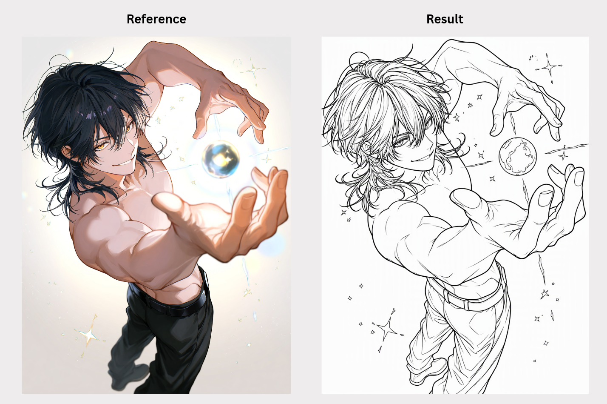

Despite the bright orb, its shape remained clear without breaking the outlines. The character, pose, and even line thickness were also preserved.

### Two Detailed Illustrations

**1. Holiday Scene**

A Christmas scene can involve tiny elements, like the ornaments, lights, and tree details, as can be seen in my Holiday illustration here: 
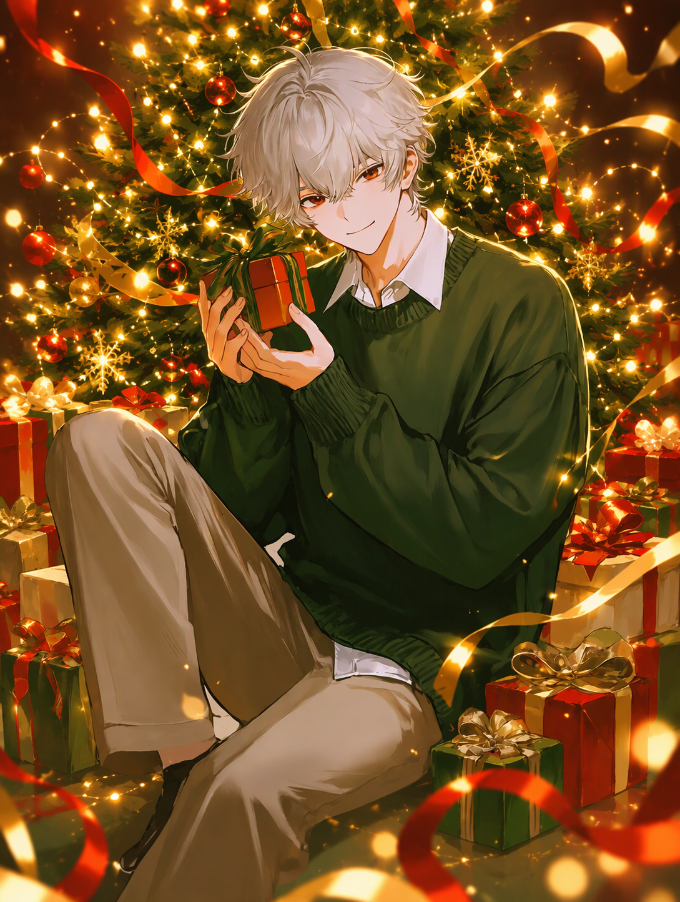

I used the same settings and prompt. Here’s the result:
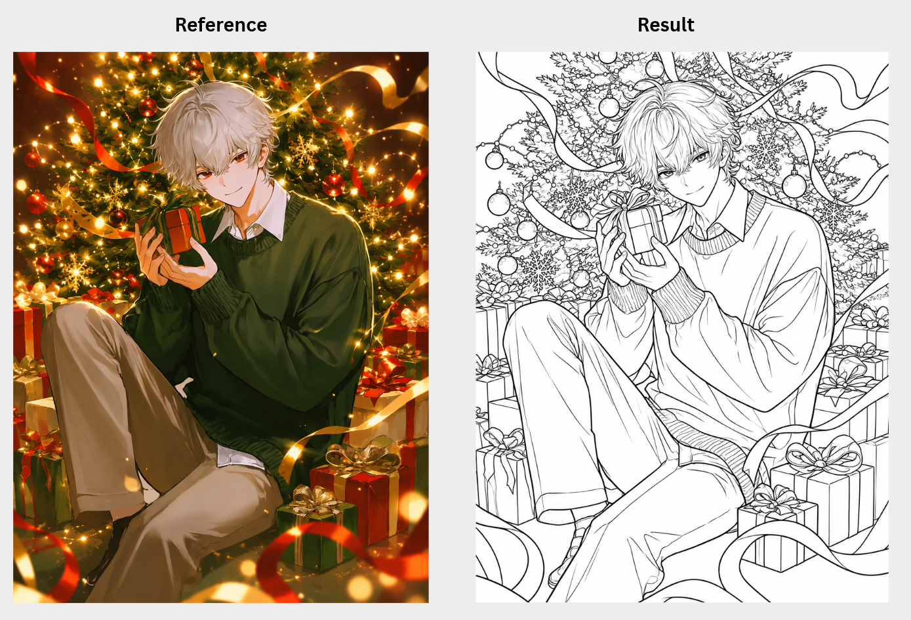

The lines are evenly thick, and all elements are preserved. However, the Christmas tree is too detailed to color easily, so we’ll simplify it later. 

**2. OC with a Background Scene**

For our final test, I used the same settings and prompt on an illustration with a background scene. 
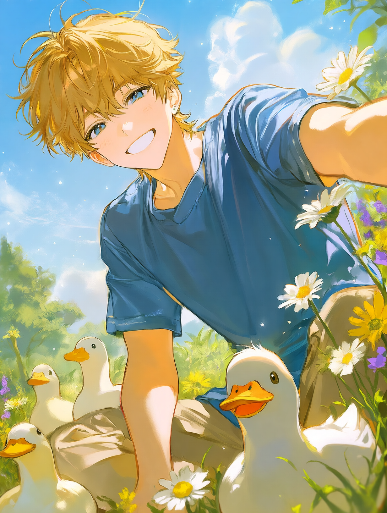

Result:
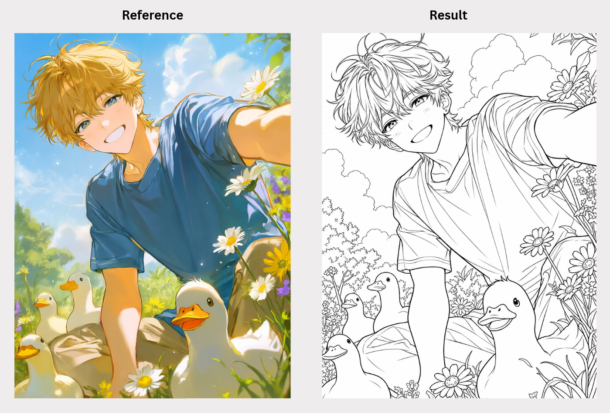

Great! The lines are clean, consistent, and free of breaks or shading. We’ve successfully created our final coloring page!

Final verdict: Use Route A with my prompt as a template to create a new scene. Choose Route B if you want to turn an existing image into a coloring page.

## Step 3 — Check Your Pages and Fix What Doesn’t Work

Before printing, double-check each result using our checklist from Section 2. Look for:

- Black outlines on a pure white background
- No gray shading, gradients, screentone, or hatching
- Clearly defined coloring areas, with closed outlines where needed for bucket filling
- Lines thick enough to stay visible when printed
- Details large enough to color easily
- 
Our main issues were thin lines in Route A’s fantasy character and crowded details on Route B’s Christmas tree. Let’s improve both using prompts or PixAI’s editing tools. 

### Fixing Route A’s Fantasy Character

Let’s refine the prompt. I asked for moderately bold, even lines this time. Here’s the revised prompt:

*"Black-and-white anime coloring page of an elegant fantasy elf musician with braided hair, pointed ears, and an elaborate off-shoulder costume with flowing sleeves, layered skirt, chains, gemstones, and heeled boots. Gracefully playing an ornate lute, full body, centered. Clean, moderately bold, even, closed outlines with clear details and large coloring areas. Pure white background, no shading or gray tones."*

Negative Prompt: Color, gray, shading, gradients, screentone, hatching, shadows, thin or faint lines, sketchy, broken, uneven, messy, or blurry outlines.

I also used the same Tsubaki.3 model and a 3:4 aspect ratio. Here’s what I got:

Great! The lines are clearer and more defined now. It kept the intricate details of the outfit and the props, but this time, it’s more simplified and outlined.

### Simplifying Route B’s Holiday Scene

Let’s simplify the Christmas tree to make it easier to color. I used PixAI Edit Pro, uploaded the coloring page, and set the aspect ratio to 3:4, resolution to 1K, and Quality to Standard. 

Prompt: 

*"Simplify the Christmas tree by reducing excessive details and ornaments. Use simple branches, fewer large ornaments, and minimal decorations. Keep its recognizable shape, clean closed outlines, consistent line thickness, and large coloring areas. Preserve the original line art style and surrounding composition."*

Result:

We’re able to simplify the design of the Christmas tree without compromising the OC’s visual elements and the other ornaments. 

We’ve generated good coloring pages from each route in each test. Here’s a recap: 
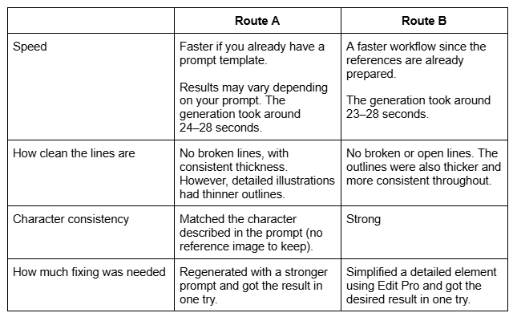

## Step 4 — Get the Page Ready to Print
Before printing, make sure to adjust some printing settings to ensure that the quality remains as it is. 

Make sure that the orientation is portrait, and the paper size fits with your generated image aspect ratio. For this image, it’s 3:4; you can click Custom paper size and input the width and height if you have that option. Ensure that the photo size is full size and the fit is set to fill the page.
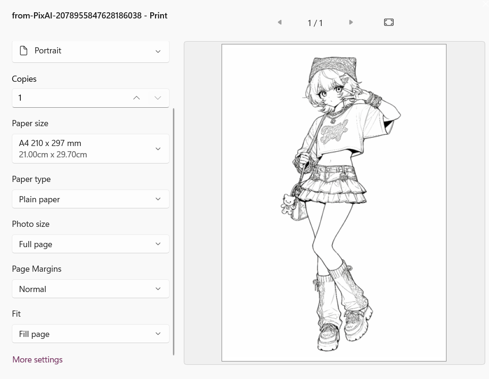

For better quality, go to More Settings and set Output Quality to High. If this option isn’t available or your print looks blurry, try upscaling your image before printing. 

I used PixAI’s [Anime Image Upscaler](https://eap.pixai.art/go/evelyn4) to try upscaling one of the generated line art. I uploaded the page and clicked Generate to enlarge it 2x. I downloaded the upscaled image and checked the file for the saved dimensions. 

Original saved dimensions: 1232 x 1632. After upscaling: 2464 x 3264. 
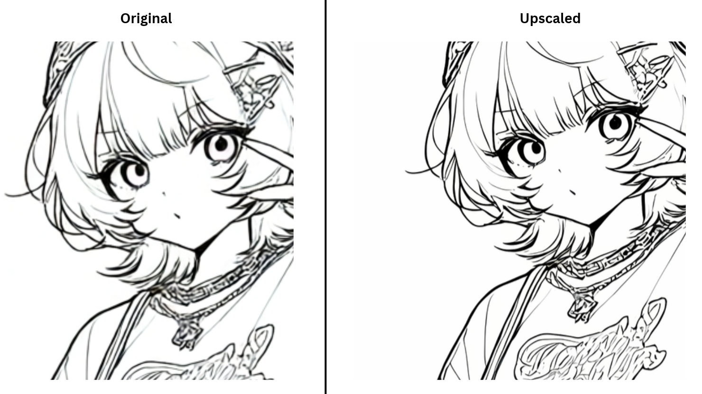

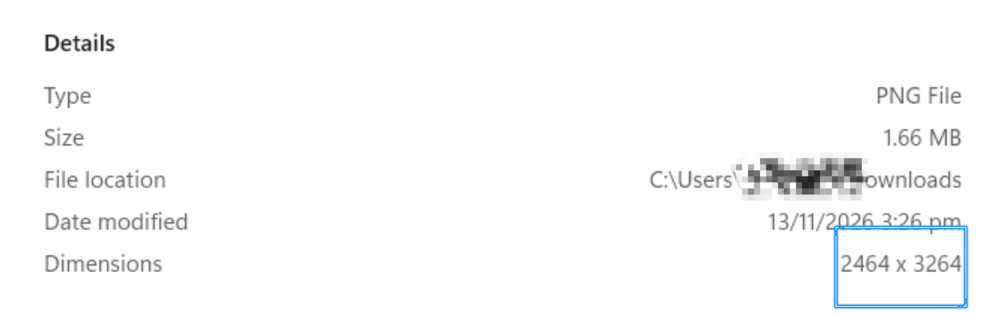

## Free Printable Anime Coloring Pages
If you liked any of the illustrations or OC that I generated here, you can save and print the pages and color them!

### Simple Coloring Pages You Can Color

**1. Chibi Character**
A simple chibi character anime OC holding a daisy. Generated straight out of the line art prompt (Route A).  

**2. Full-body OC**
Full-body illustration of an anime girl with more outfit instruction, generated through Route A (prompt).

**3. Furry OC**
Furry OC simple illustration generated through Route B (OC reference). 

**4. Magical Pose**
Simple illustration of an anime male OC in a magical pose, generated with Route B’s approach (OC reference). 

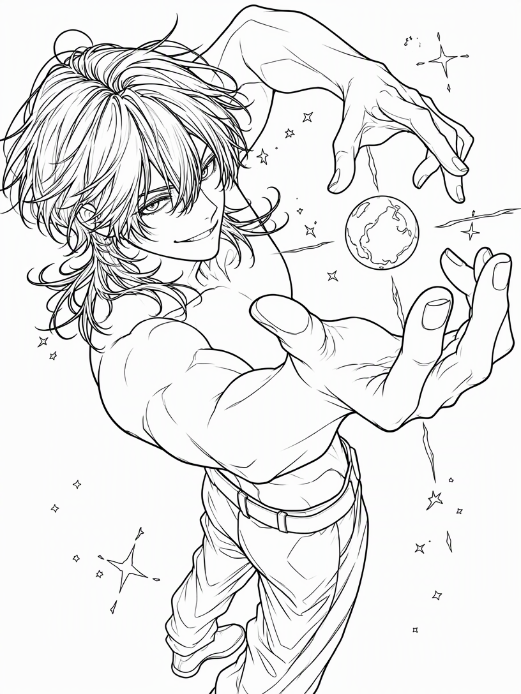

### Detailed Illustrations You Can Save

**1. Character with a Pet**
Detailed illustration of an anime warrior with a fluffy wolf, generated through Route A approach (prompt). 

.png?raw=true)

**2. Fantasy Character**
A detailed fantasy character illustration with a prop, generated through Route A approach (prompt).

**3. Holiday Scene**
A detailed holiday scene with Christmas ornaments, generated through Route B’s approach (OC reference). 

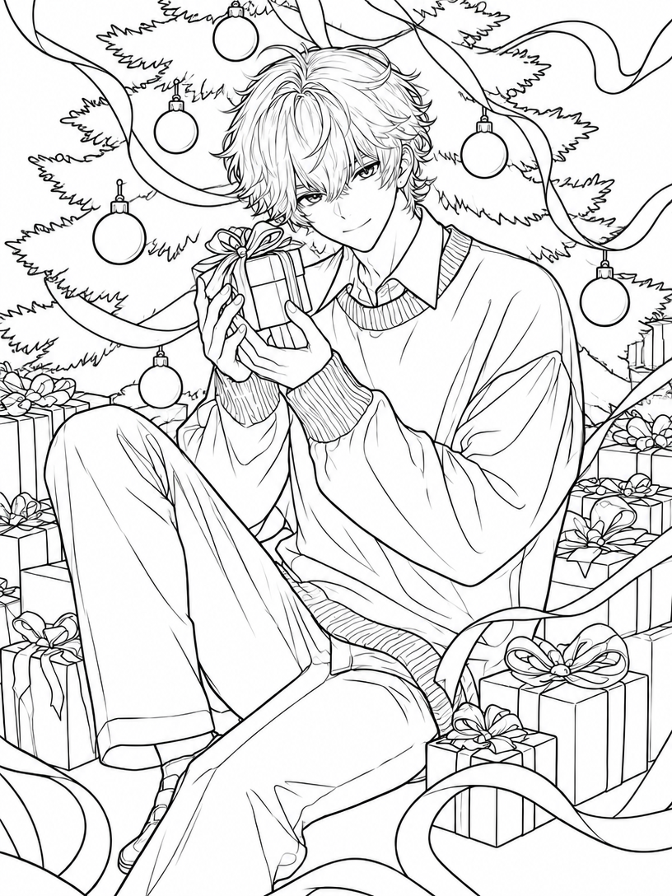

**4. OC with a Background Scene**
	A detailed illustration of a character in an outdoor setting, generated through Route B approach (reference). 

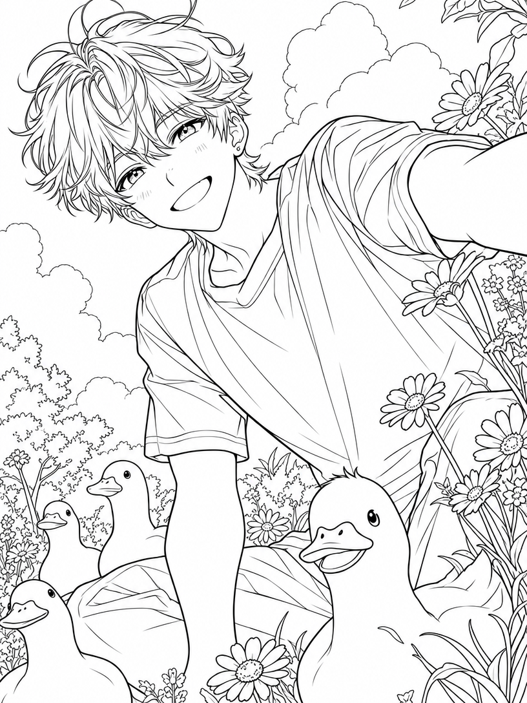 

## Conclusion
Ready to create your own **anime coloring pages**? Try designing a new OC or scene through AI, or turn your existing illustrations into pages you can color. 

Here’s a quick recap of the workflow that I tested here: Choose your subject, pick Route A (prompt) or Route B (existing illustration), check the result, make any adjustments, then print with the right settings. With the right prompts, settings, and adjustments, you can turn your anime illustrations into printable coloring pages with [PixAI](https://eap.pixai.art/go/evelyn). 
