# Create Your Own Anime Coloring Pages With AI
Finding **anime coloring pages** with designs you like isn't always easy. AI offers another option, but getting clean, printable line art takes some testing. 

I tried two approaches with [PixAI](https://eap.pixai.art/go/evelyn): generating line art from prompts (Route A) and converting existing illustrations (Route B), producing 8 coloring pages in total.

## Coloring Page Basics
Good anime coloring pages should have: 

- Black outlines on a pure white background
- No gray shading, gradients, screentone, or hatching
- Closed outlines for clear coloring areas
- Print-friendly line thickness
- Details that are easy to color

Choose simple shapes for kids and more detailed designs for adults.

## Step 1 — Route A: Text-to-Image Line Art
Line art styles affect outline thickness and consistency. We'll test four designs: two simple and two detailed. 

Let’s set up our canvas to start:  

1. To begin, open the PixAI image generator and click **Generate** to start a new canvas.
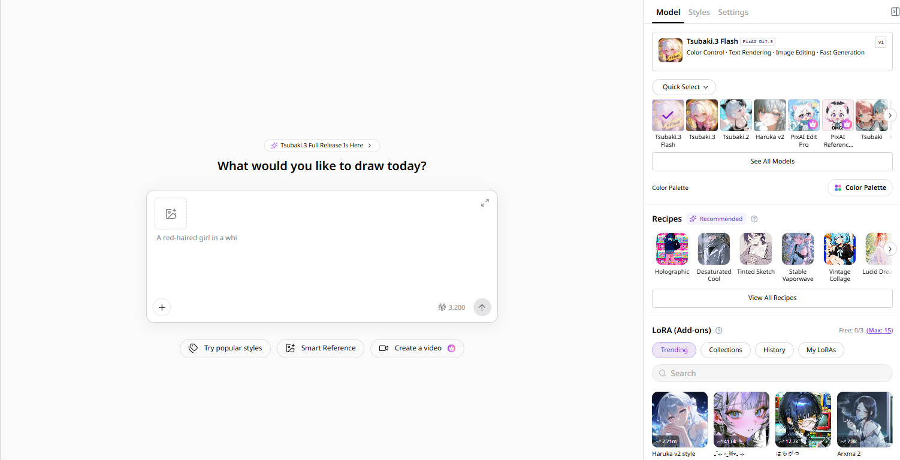
2. Under Model Selection or Quick Select, choose [Tsubaki.3](https://eap.pixai.art/go/evelyn2)

3. Open Settings and adjust the Generation Speed, Number of Images, and Resolution. Choose an aspect ratio based on your page size. I used a 3:4 portrait, which is close to A4 proportions.

4. Use the [Tsubaki.3 Prompt Guide](https://blog.pixai.art/en/tsubaki-3-prompt-guide/) or the tested prompts below. Customize the character and scene details, then paste them into the main and Advanced (negative prompt) fields.

### Simple Line Art Designs
We'll create two simple designs: a chibi character and a full-body OC, using the same model and settings. 
1. **Chibi Character**
   
Prompt:

*"Black-and-white chibi coloring page of a cute girl with long twin tails, a frilly dress, and hair accessories. Full body, one leg bent, holding a daisy, with large flowers and sparkles. Bold, even, closed outlines, large coloring areas, and pure white background. No color, shading, or gray tones."*

Negative prompt:
color, gray, shading, gradient, screentone, hatching, shadow, text, watermark, signature, frame

Result:
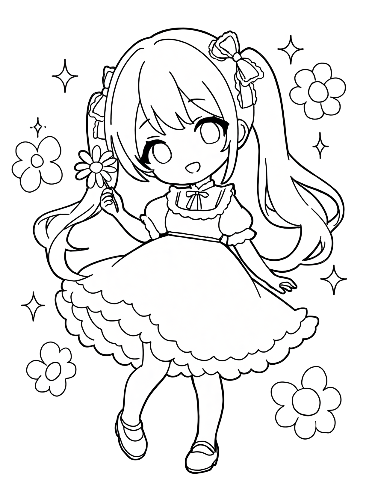 

The chibi OC includes the requested details and clean, closed outlines.

Use the same negative prompt for all four Route A pages. Only change it when fixing a page in Step 3.

**2. Full-body OC**

I changed the character, pose, and outfit while keeping the same prompt structure. I also added the optional [椿](https://pixai.art/model/2077503995142358039/2077503995675034663) community LoRA at 0.7 strength to guide the OC's face.

Prompt: 

*"Black-and-white anime coloring page of a full-body girl with fluffy short hair, patterned beanie, oversized cropped top, layered skirt, leg warmers, platform shoes, and charm-decorated bag. Stylish crossed-leg pose, holding her bag strap and making a peace sign. Bold, even, closed outlines, large coloring areas, and pure white background. No color, shading, or gray tones."* 

Result: 
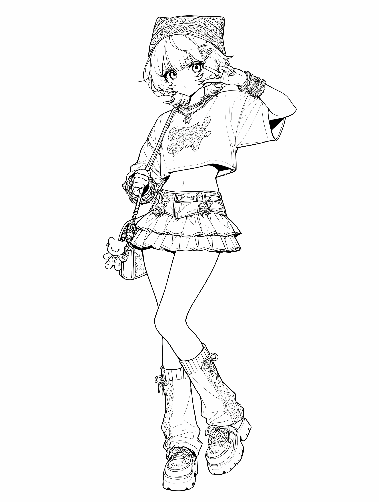 

The LoRA kept the outlines thick and consistent. Despite the detailed outfit, the result has no visible open lines or gray shading.

### Detailed Line Art Designs
Let's create two more detailed coloring pages.

**1. Character with A Pet**

I added more outfit and pose details, along with a wolf companion, while keeping the same prompt structure. 

Prompt: 

*"Black-and-white anime coloring page of a wolf-eared female warrior with messy hair, armor, fur mantle, and a sword on her back. She rides a massive, muscular direwolf with thick fur and a leather harness. Dynamic three-quarter view, full body, centered. Bold, even, closed black outlines, large coloring areas, and pure white background. No color, shading, or gray tones."*

Result:
.png?raw=true)

The thinner outlines still remain clean and recognizable, with no visible gaps or broken lines.

**2. Fantasy Character**

Fantasy outfits and props often have intricate details. Let's see if the model can keep the outlines clear.

Prompt:

*"Black-and-white anime coloring page of an elegant elf musician with braided hair, pointed ears, and an elaborate off-shoulder outfit with flowing sleeves, layered skirt, gemstones, ribbons, and boots. Gracefully playing a fantasy lute, full body, centered. Bold, even, closed outlines, large coloring areas, and pure white background. No color, shading, or gray tones."* 

Result:

The character, outfit, and props were preserved, but the thin facial lines may be hard to color. The outlines are closed, but thicker lines would help. We'll fix this in Step 3. 

## Step 2 — Route B: Turn an Existing OC Illustration Into a Coloring Page
Use PixAI Edit Pro to convert existing illustrations into coloring pages. We'll test four images: two simple and two detailed.

Use the same editing prompt for all four.

*"Use the uploaded image as the sole reference. Convert it into clean black-and-white coloring line art while preserving the exact character, details, pose, proportions, and composition. Use crisp, smooth outlines with consistent weight and enclosed coloring areas. Pure white background, no color, shading, grayscale, or solid black areas. Add or remove nothing."* 

### Simple Illustrations

**1. Furry Character**
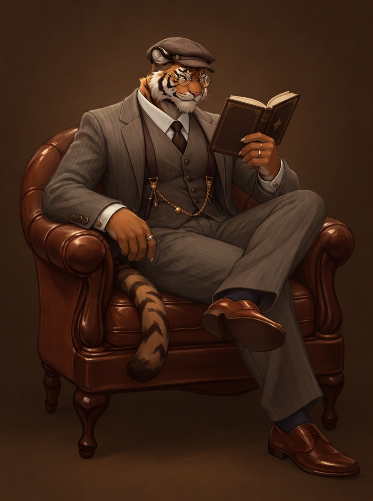

To start, we need to set up our model and settings:  

1. Click **+ Create a new image** to open a new canvas. Under Model Selection, choose [PixAI Edit Pro](https://eap.pixai.art/go/evelyn3).
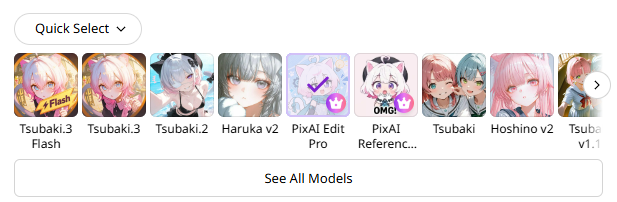

2. Open Settings, select your preferred Resolution and Quality, and set the aspect ratio to 3:4 portrait.

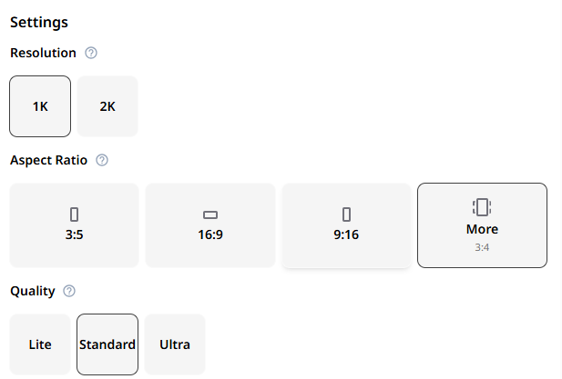

4. Upload your illustration using the image uploader icon.

Paste the editing prompt into the prompt box:  
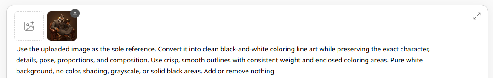

Result:
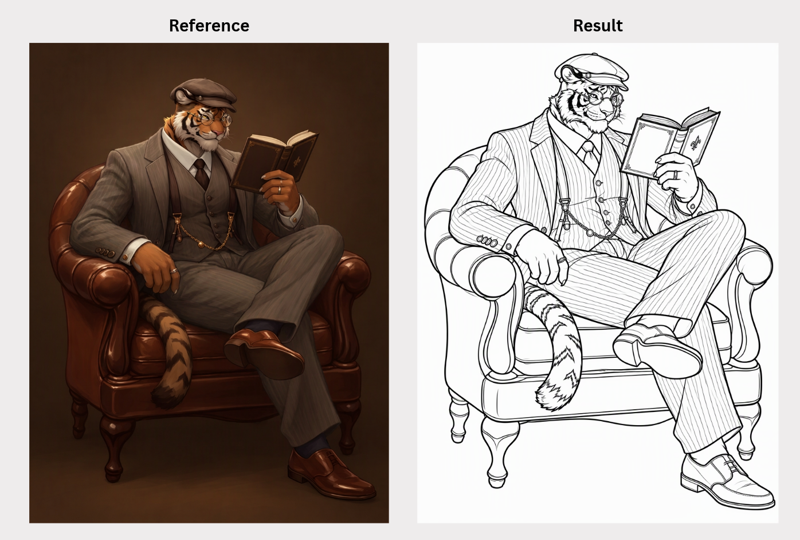

The result has thicker, more even outlines and clearer facial and ear details while keeping the line art clean.

**2. Magical Pose**

The second OC has a bright magical orb. Let's see how well the same settings and prompt handle the glowing details.
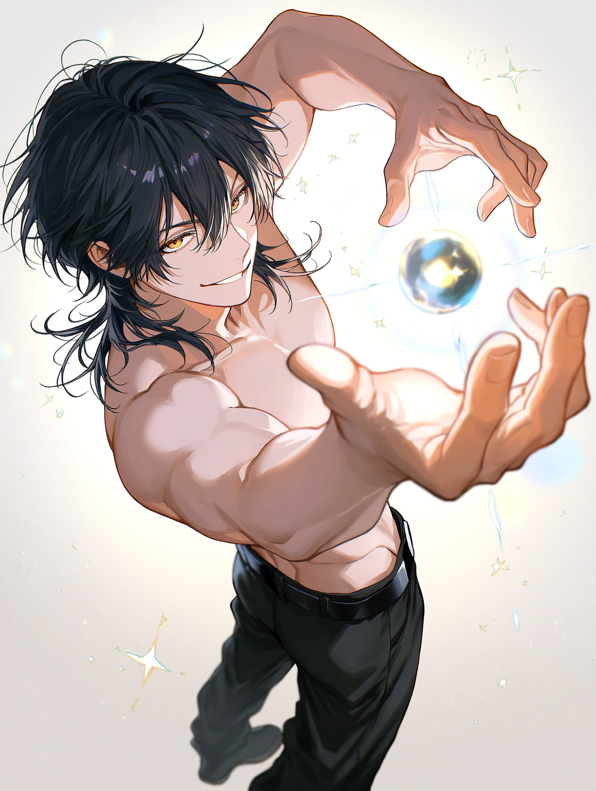

Result:

The bright orb kept its shape without breaking the outlines. The character, pose, and line thickness were also preserved. 

### Detailed Illustrations

**1. Holiday Scene**

Christmas scenes contain many small details, such as ornaments, lights, and decorations. Let's see how PixAI handles my holiday illustration. 

I kept the same settings and editing prompt. Here's the result:

The outlines are even, and the details are preserved. However, the Christmas tree needs simplifying for easier coloring. 

**2. OC with a Background Scene**

For the final test, I used the same settings and prompt on an illustration with a background. 

Result:

The final page has clean, consistent outlines with no visible gaps or shading.

Final Verdict: Use Route A to create new designs from prompts, or Route B to convert existing illustrations into coloring pages.

## Step 3 — Review and Fix Your Coloring Pages
Before printing, review each page using the Section 2 checklist. 

- Black outlines on a pure white background
- No gray shading, gradients, screentone, or hatching
- Clearly defined coloring areas, with closed outlines where needed for bucket filling
- Lines thick enough to stay visible when printed
- Details large enough to color easily

Our main issues were thin lines in Route A's fantasy character and crowded details on Route B's Christmas tree. Let's fix both using prompts and PixAI editing tools.

### Fixing Route A: Fantasy Character

I revised the prompt to request moderately bold, even outlines for better coloring.

Revised prompt: 

*"Black-and-white anime coloring page of an elegant fantasy elf musician with braided hair, pointed ears, and an elaborate off-shoulder costume with flowing sleeves, layered skirt, chains, gemstones, and heeled boots. Gracefully playing an ornate lute, full body, centered. Clean, moderately bold, even, closed outlines with clear details and large coloring areas. Pure white background, no shading or gray tones."*

Negative Prompt: Color, gray, shading, gradients, screentone, hatching, shadows, thin or faint lines, sketchy, broken, uneven, messy, or blurry outlines.

I kept the Tsubaki.3 model and 3:4 aspect ratio. Here's the result: 
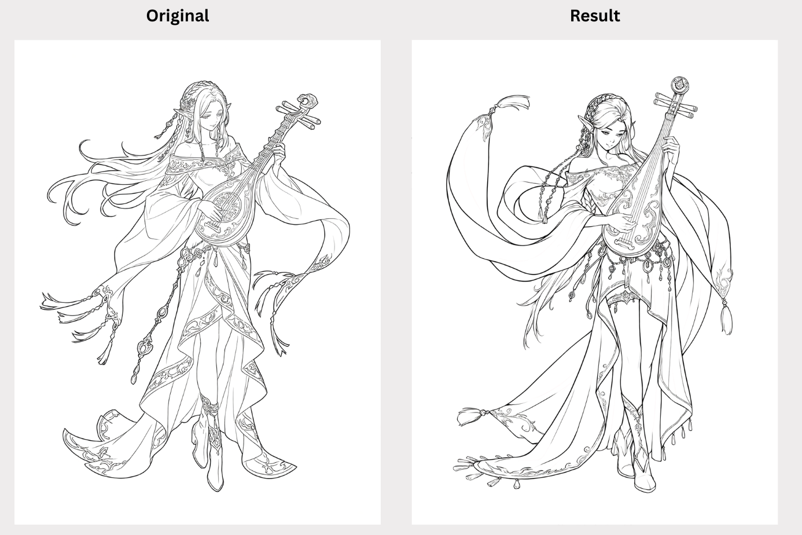

The lines are clearer and more defined while keeping the outfit and props recognizable. The details are also simplified for easier coloring. 

### Simplifying Route B: Holiday Scene

To make the Christmas tree easier to color, I used PixAI Edit Pro with the coloring page as a reference. Settings: 3:4 aspect ratio, 1K resolution, and Standard quality.  

Prompt:  

*"Simplify the Christmas tree by reducing excessive details and ornaments. Use simple branches, fewer large ornaments, and minimal decorations. Keep its recognizable shape, clean closed outlines, consistent line thickness, and large coloring areas. Preserve the original line art style and surrounding composition."*

Result:
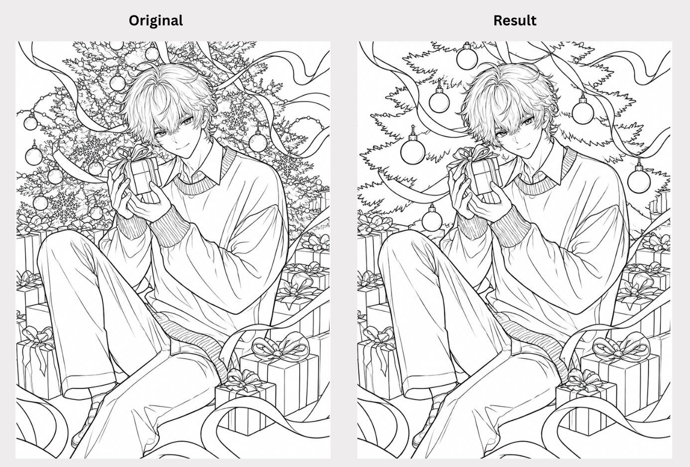

The Christmas tree is now simpler to color, while the OC and other ornaments remain intact.

Both routes produced usable coloring pages. Here's a recap of the results: 
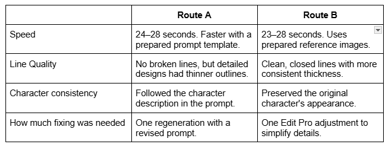 

## Step 4 — Prepare Your Coloring Pages for Printing 
Adjust the print settings to match your image:

- Orientation: Portrait.
- Paper size: Match the 3:4 aspect ratio. Use Custom Paper Size if available.
- Photo size: Full size
- Fit: Fill the page
  
This helps maintain the image's proportions and print quality.

For sharper prints, set Output Quality to High under More Settings. If unavailable or the image looks blurry, use PixAI's [Anime Image Upscaler](https://eap.pixai.art/go/evelyn4)  

Upload your coloring page, click Generate, and select the 2x result. Download and check the dimensions:

- Original: 1232 × 1632
- Upscaled: 2464 × 3264

## Free Printable Anime Coloring Pages
Here are the 8 coloring pages from the test, arranged from simple to detailed. Save and print them for personal use. 

### Simple Coloring Pages You Can Color

**1. Chibi Character**

Chibi anime OC holding a daisy (Route A).  

**2. Full-body OC**

Full-body anime girl with detailed outfit (Route A). 

**3. Furry OC**

Simple furry OC (Route B).  

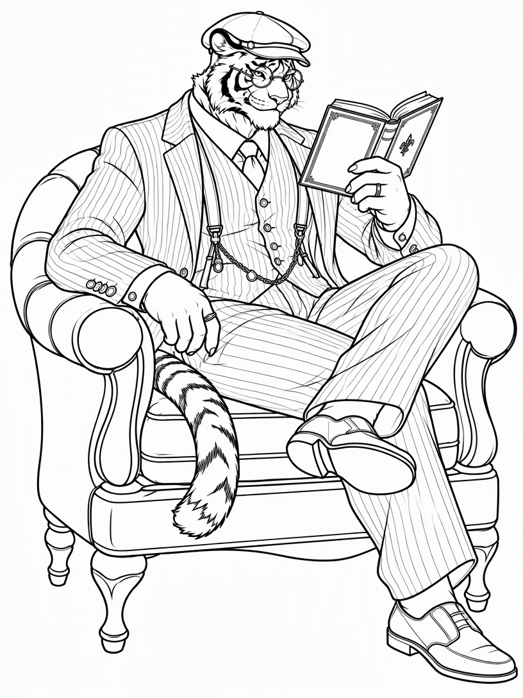

**4. Magical Pose**

Anime male OC in a magical pose (Route B).  

### Detailed Illustrations You Can Save

**1. Character with a Pet**

Anime warrior with a fluffy wolf (Route A). 

.png?raw=true)

**2. Fantasy Character**

Fantasy character with a prop (Route A). 

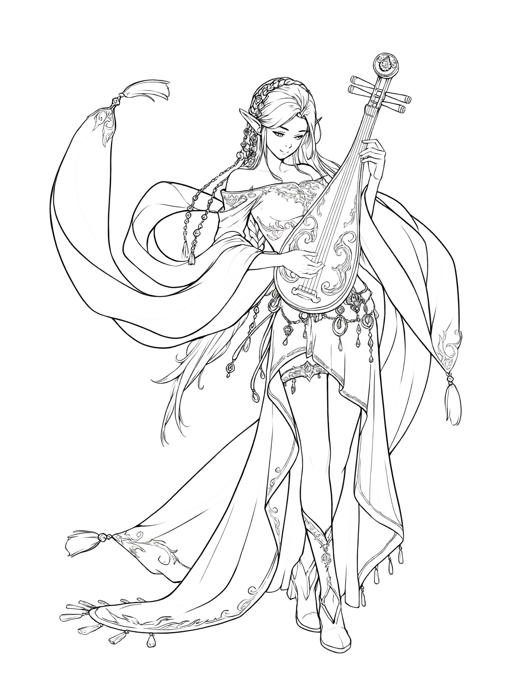

**3. Holiday Scene**

Detailed Christmas scene with ornaments (Route B). 

**4. OC with a Background Scene**

	Character in a detailed outdoor scene (Route B). 

 

## Conclusion
Create your own **anime coloring pages** with a new OC, an original scene, or an existing illustration.

Choose Route A (text prompt) or Route B (existing illustration), review the results, make any needed adjustments using [PixAI](https://eap.pixai.art/go/evelyn), and prepare your pages for printing! 
