# Creating Anime Boy PFPs with PixAI
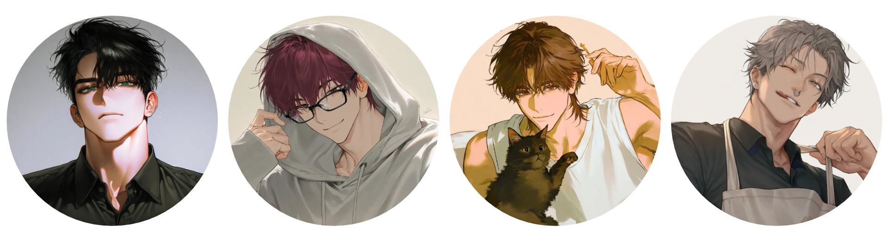 

**Anime boy PFPs** are a simple way to give an online profile its own identity. Instead of using an existing character, you can generate an original anime boy based on your preferred appearance, outfit, and aesthetic.

For this project, I created 10 anime boy avatars using [PixAI](https://eap.pixai.art/go/evelyn) and Tsubaki.3, exploring five different styles. I also tested a few edits to improve character details and make the images work better as profile pictures.

## 10 Anime Boy Avatar Ideas in 5 Styles
I divided the designs into five styles, with two characters for each category.
### 1. Cool and Classic
- **Blonde gentleman**: A sophisticated blonde character with a sharp jawline, broad shoulders, glasses, and an olive-green pullover.
Prompt: 

[Head-and-shoulders anime portrait of a handsome young man, centered in the frame with generous clean headroom above his hair, looking directly at the viewer with a calm expression. He has elegant blonde hair, medium-length layered strands with a natural middle part and soft curtain bangs framing his face. Defined masculine jawline, prominent cheekbones, straight nose, slightly narrow eyes, broad shoulders and a thick neck. He wears an oversized dark olive-green pullover over a simple white shirt with a slightly open collar, and black-framed glasses hanging casually from the neckline. Plain soft green background. Soft frontal lighting, clean anime illustration style, refined linework and natural-looking proportions. Leave 20% of the image as space above his head.] 

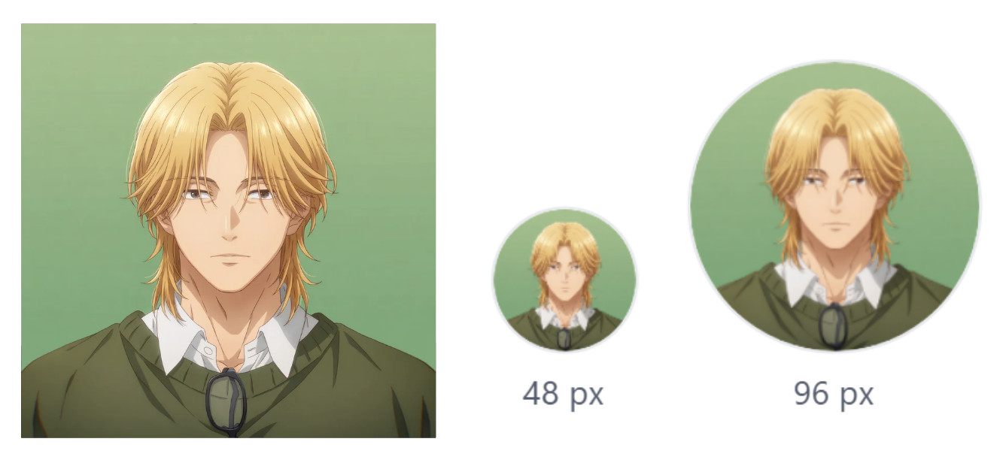 

- **White-haired schoolboy:** A confident schoolboy with crimson eyes, messy white hair, and a relaxed pose.
Prompt:

[Head-and-shoulders anime portrait of a handsome young man, centered in the frame, with one arm raised above his head and his hand casually running through his tousled hair. He has layered snow-white hair with slightly messy, voluminous strands, striking crimson-red eyes, a defined masculine jawline, sharp yet youthful facial features, and a subtle, confident smile. He wears a simple white collared school uniform shirt with the top button casually undone and a slightly loosened dark red tie. His appearance is effortlessly charming, relaxed and confident. Both shoulders are visible within the frame. Plain muted sky-blue background, soft frontal lighting, clean anime illustration style with delicate shading and refined linework. Leave 20% of the image as space above his head.]

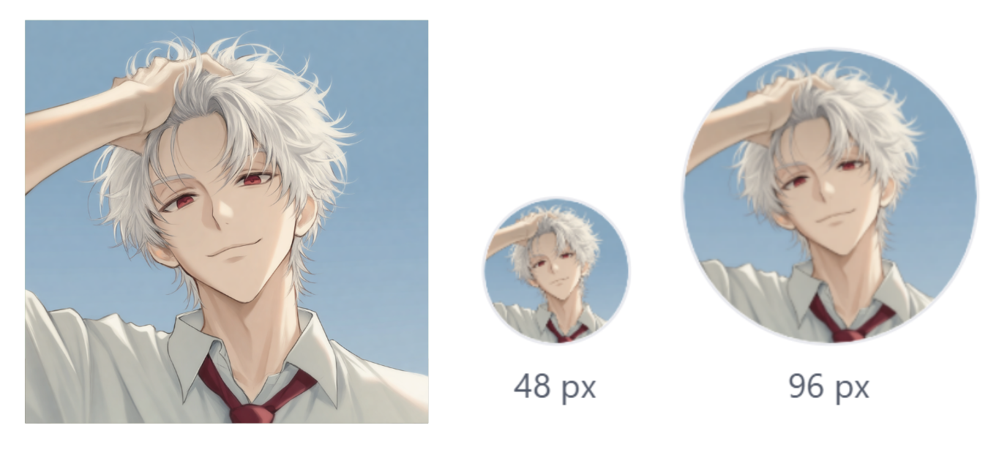 

No additional LoRAs were used for these two designs.

### 2. Dark and Mysterious
- **Mysterious CEO:** A black-haired character with emerald eyes, a fitted black shirt, and a commanding appearance. LoRA: [LOVE BOMB：1129](https://pixai.art/model/2079562446775499619/2079562447392062327) (0.7).
Prompt:

[Head-and-shoulders anime portrait of a man, centered in the frame, with generous clean headroom above the hair, looking at the viewer with a composed expression. Tousled, slightly messy jet-black hair, masculine jawline, prominent cheekbones, emerald-green eyes, and a broad, thick neck. He wears a black fitted dress shirt slightly unbuttoned at the collar. Plain soft gray background. Soft light from the front, clean anime illustration style. Leave 20% of the image as space above his head.] 

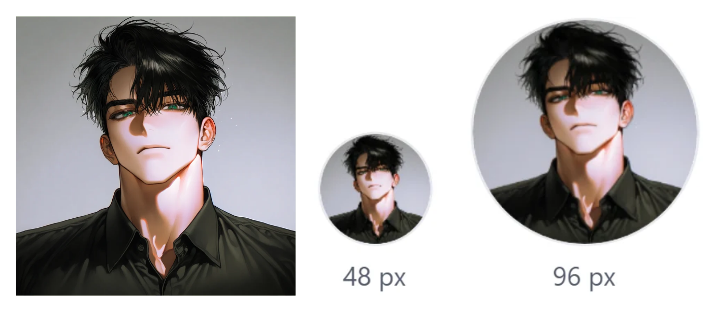

- **Emo musician:** An ash-blonde character with black eyes, a lip piercing, earphones, and layered silver necklaces. LoRA: [.⋆𝜗𝜚.†⋆](https://pixai.art/model/2038084087050852290/2080540904246318466) (0.7).
Prompt:

[Head-and-shoulders anime portrait of a man, centered in the frame, with generous clean headroom above the hair, looking at the viewer with a tired, melancholic expression. Messy, layered ash-blonde hair with long wispy bangs partially covering one eye, half-lidded eyes, a labret piercing below his lower lip, and white earphones hanging on his ears, masculine jawline, prominent cheekbones, black eyes, and a broad, thick neck. He wears a black loose shirt with layered silver necklaces. Plain blue-grey background. Soft light from the front, clean anime illustration style. Leave 20% of the image as space above his head.] 

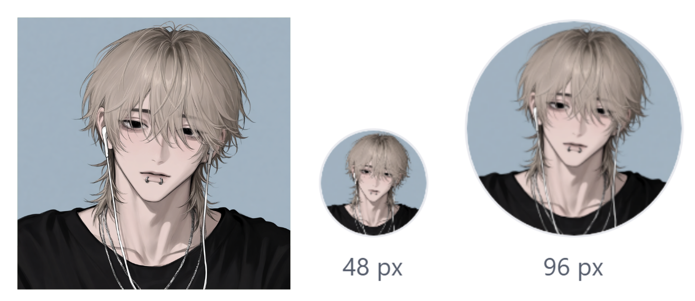 

### 3. Soft and Dreamy
- **Bunny boy:** A pastel-blue-haired character wearing an oversized bunny hood. LoRA: [まいろら🩵](https://pixai.art/model/2080036059084887854/2080036059890194247) (0.7).
Prompt: 

[Head-and-shoulders anime portrait of a handsome young man, centered in the frame, leaning slightly forward with both hands gently holding the sides of an oversized cream-colored plush bunny hood with long, floppy rabbit ears. He has soft, fluffy, tousled pastel light-blue hair with wispy bangs framing his face, gentle light-blue eyes, masculine facial features, and a sweet, gentle expression. A tiny pink heart-shaped sticker is placed on one cheek. He wears a simple oversized white crew-neck T-shirt. His overall appearance is masculine and gentle. Plain pastel light-yellow background, minimal and uncluttered. Soft diffused lighting, delicate pastel shading, clean anime illustration style with fine linework. Leave 20% of the image as space above his head.]

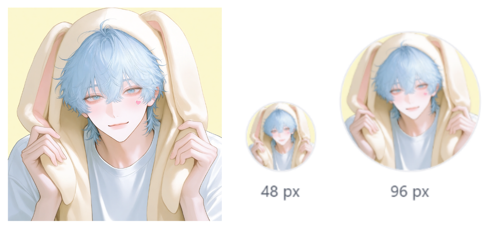 

- **Cat lover:** A brown-haired character with a gentle expression, relaxing with a fluffy cat. LoRA: [今月の処方箋](https://pixai.art/model/2076784683159332555/2076784683884947182) (0.7).
Prompt:

[Head-and-shoulders anime portrait of a handsome young man reclining in a relaxed pose, with one arm raised casually near his hair, holding a cat treat. A fluffy black-and-brown cat rests against his chest, with one paw playfully raised, centered on the frame. He has soft, tousled medium-brown hair with layered, slightly messy strands framing his face, warm brown eyes, delicate yet masculine facial features, and a gentle, subtle smile as he looks towards the viewer. He wears an oversized plain white sleeveless tank top with a loose fit and relaxed neckline. The cat remains clearly visible in the foreground, close to his chest. His overall appearance is warm, affectionate and effortlessly charming. Plain pastel peach-beige background. Soft warm lighting, delicate shadows, clean anime illustration style with refined linework and gentle shading. Leave 20% of the image as space above his head.]

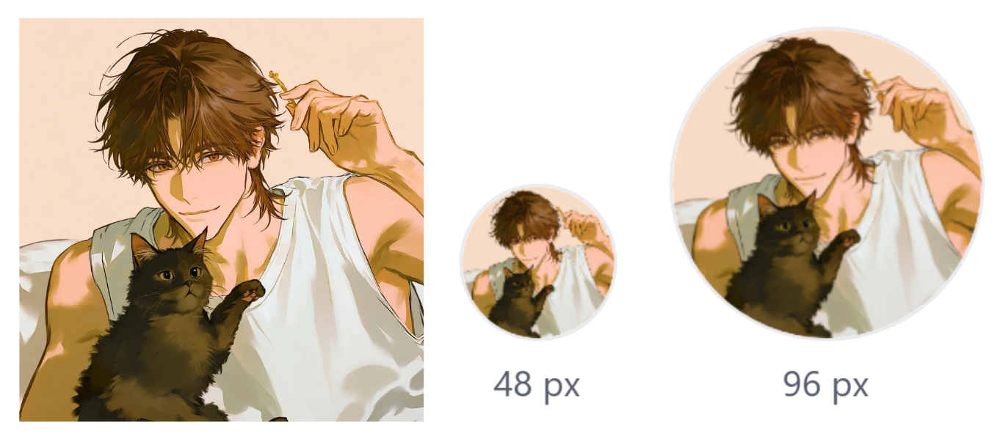 

### 4. Glasses and Intellectual
- **Bookworm:** A burgundy-haired character wearing black rectangular glasses and a gray hoodie. LoRA: [なみなみ](https://pixai.art/model/2078649828369721917/2078649828982090319) (0.7).
Prompt:
 
[Head-and-shoulders anime portrait of a handsome young man, positioned slightly at an angle with his head tilted down and to the side, wearing a subtle, playful smile as he looks towards the viewer through his glasses. One hand is casually raised near his face, with his fingers lightly touching the edge of his hood. He has tousled, layered deep burgundy-red hair with messy strands falling naturally over his forehead. He wears stylish black rectangular eyeglasses with subtle reflections. His facial features are refined and masculine, with a defined jawline and a relaxed, charming expression. He wears an oversized light-grey hoodie with the hood pulled over his head, framing his face. Plain, warm, dirty-white background. Gentle frontal lighting softly illuminates his face, creating delicate shadows. Clean anime illustration style with refined linework and soft shading. Leave 20% of the image as space above his hood, keeping the entire hood visible.] 

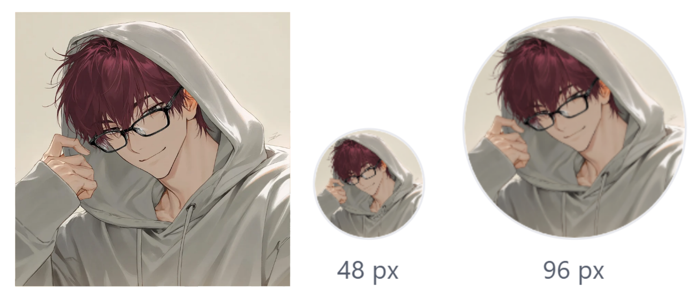 

- **Mysterious intellectual:** A dark navy-haired character with oversized glasses and a serious expression. LoRA: [k](https://pixai.art/model/2079537096716192777/2079537097555053611) (0.7).
Prompt:

[Head-and-shoulders anime portrait of a handsome young man, centered in the frame, with generous clean headroom above his hair, looking directly at the viewer with a serious, composed expression. Tousled, voluminous dark navy-blue hair with layered strands and subtle blue highlights, striking deep navy-blue eyes, sharp eyebrows, and a well-defined masculine jawline. Both hands are raised to cover his mouth and lower face, with fingers gently resting against his cheeks, recreating a shy yet captivating pose. He wears oversized, thick black rectangular glasses with large clear lenses, properly fitted over his eyes, and a black collared jacket over a simple dark shirt. Plain, soft dirty-white background. Soft, diffused light from the front, clean anime illustration style with expressive linework and painterly shading. Leave 20% of the image as space above his head.] 

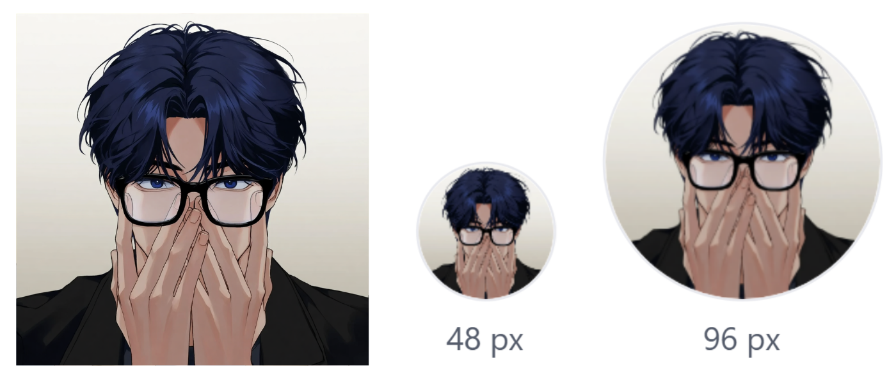 

### 5. Streetwear
- **DJ:** A pink-haired character with headphones, a patterned jacket, and a confident pose. LoRA: [s_dark/🅽](https://pixai.art/model/2080734838451876664/2080756914770495422) (0.7).
Prompt:

[Head-and-shoulders portrait of a handsome anime-style male character with a short, neatly trimmed pink buzz cut, sharp facial features, and a confident, mischievous smirk. His upper body is slightly turned away from the viewer while his head looks back over his shoulder, creating a dynamic three-quarter pose. One hand casually grips the collar of his oversized zip-up jacket, slightly pulling it up. He wears a jacket featuring intricate baroque-inspired swirling patterns, ornate illustrations across the chest and sleeves, and bold graphic lettering. Large over-ear headphones hang loosely around his neck. His expression is playful and self-assured, with a slightly raised eyebrow. Black background, refined anime illustration style, expressive linework and painterly shading. Leave 20% of the image as space above his head.] 

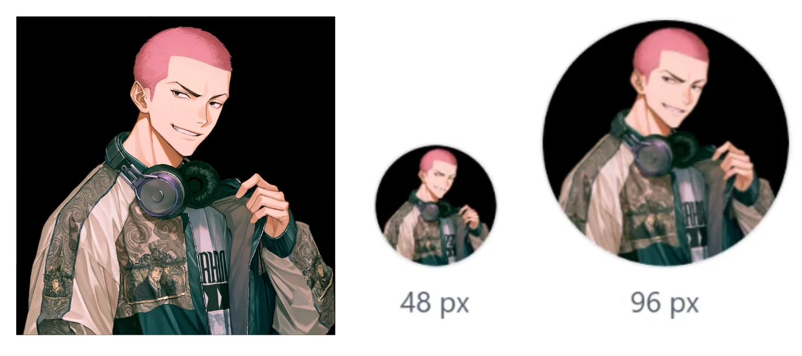 

- **Skater boy:** A long-haired character wearing a blue beanie, graphic shirt, and silver necklaces. LoRA: [貴方の残像15](https://pixai.art/model/2081439538010866017/2081439538593874283)  (0.7).
Prompt:

[Head-and-shoulders portrait of a handsome anime-style male character with long, slightly messy black hair flowing beneath a deep blue beanie. He has a wide, playful grin with slightly squinted eyes, showing his teeth and a small lip piercing. He wears an oversized white graphic T-shirt featuring a bold abstract design in deep navy blue, muted red, and white, with layered geometric shapes, distressed textures, and dynamic brushstroke patterns. A black inner shirt and silver chain necklaces complete his outfit. His pose is energetic and expressive, with one hand raised beside his cheek in a playful clenched-fist gesture, with his thumb pointing at his face, his head slightly tilted and shoulders angled towards the viewer. Dynamic close-up composition, cheerful and mischievous expression, soft clean background, refined anime illustration style with expressive linework, painterly shading, and natural proportions. Leave 20% of the image as space above his head.]

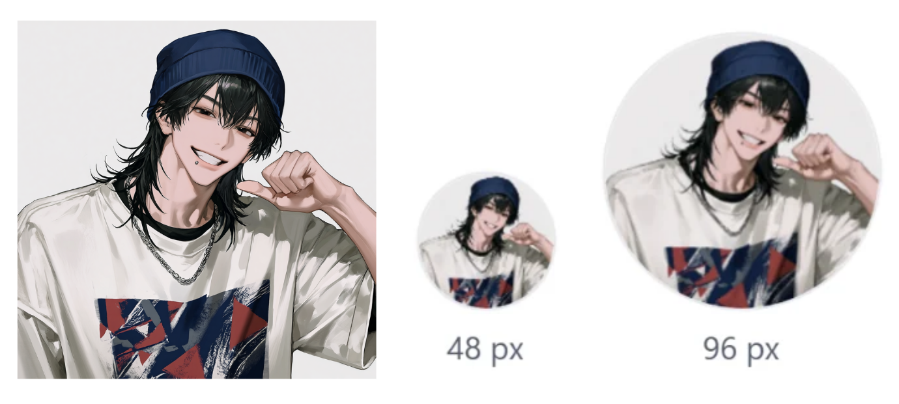 

## Generation Settings
The following settings were used for the 10 avatar designs:

| **Setting** | **Value** | 
| --- | --- |
| Model | Tsubaki.3 |
| Aspect Ratio | 1:1 Portrait |
| LoRA strength | 0.7 (when used) |

**Shared negative Prompt:** 
[text, watermark, signature, frame, full body, cropped head, extra people]

For profile pictures, I recommend using a head-and-shoulders composition, keeping the face near the center, and leaving enough space above the character's head.

## Creating a Custom Anime Boy PFP
You can also generate a new character instead of using the 10 designs above.

For my example, I created a barista OC with ash-gray hair, a playful wink, a nose ring, and a café-inspired outfit.

Prompt:

[Head-and-shoulders portrait of a handsome, masculine anime-style male character with short, stylish ash-gray hair, slightly tousled with textured layers and a few loose strands framing his face. He has one eye playfully closed in a wink, his tongue slightly sticking out with a cheeky grin, and a noticeable dimple on his cheeks. He wears a stylish barista outfit consisting of a dark fitted shirt, a neatly tied apron, and subtle café-inspired details. A small silver nose ring and simple ear piercings complete his look. His pose is relaxed and charismatic, with his head slightly tilted and one hand casually adjusting his apron strap. Dynamic close-up composition, simple dirty-white background, expressive anime illustration style, detailed linework, soft painterly shading, and natural masculine proportions. Leave 20% of the image as space above his head.] 
	
Negative prompt: 

[lowres, worst quality, low quality, bad anatomy, explicit, text] (For this one I switched to a quality-focused negative prompt instead of the shared one above.)

I selected [Tsubaki.3](https://eap.pixai.art/go/evelyn2), set the image ratio to 1:1, and generated four variations. For more prompt writing tips, you can [read the PixAI Tsubaki.3 prompt guide](https://blog.pixai.art/en/tsubaki-3-prompt-guide/). 

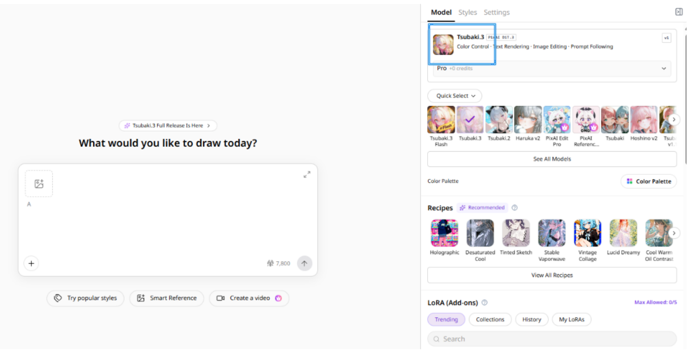

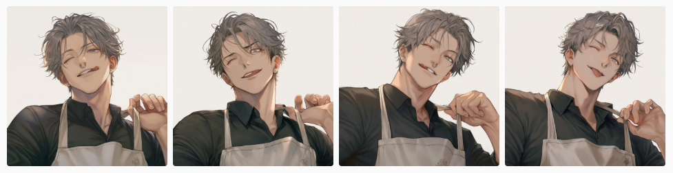 

After choosing the result with the clearest face and framing, I used PixAI Edit Pro to add the missing dimples.

Editing Prompt: 

[Use Image 1 as the only character reference. Keep the character, expression, and pose. Add noticeable dimples on his cheeks.] 

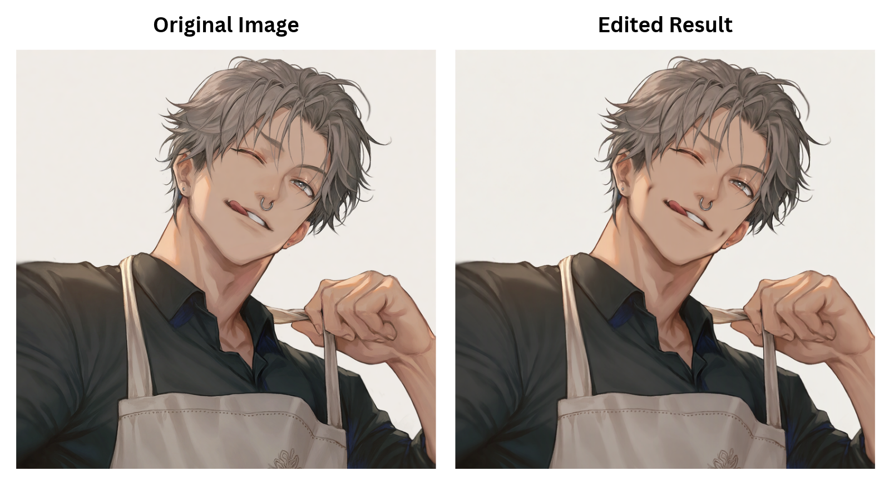 

At the time of testing, generating four images with High Priority cost **9,800** credits, while the Edit Pro adjustment cost **8,000** credits.

## Refining Characters With Edit Pro

Some generated characters needed additional adjustments to better match their intended appearance. I also used the PixAI Edit Pro to edit the avatars. 

**Bunny boy**: The original design looked too feminine in a small circular crop. I kept the pastel aesthetic but adjusted his jawline and hand pose.

Editing Prompt: 

[Use Image 1 as the only character reference. Pose one hand beside his face in a backward-facing peace sign, showing the back of his hand toward the viewer, with two fingers raised in a natural V shape. Give him a stronger, masculine jawline.] 

Result: 
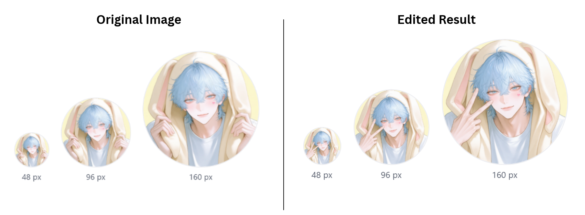 

**Skater boy:** His long hair and lean build made him look more androgynous. I shortened his hair and broadened his upper body while preserving his original outfit and face.

Editing Prompt: 

[Use Image 1 as the only character reference. Give him a more muscular, broader upper body and shorter, slightly tousled hair while keeping his original face, outfit, and anime style.]

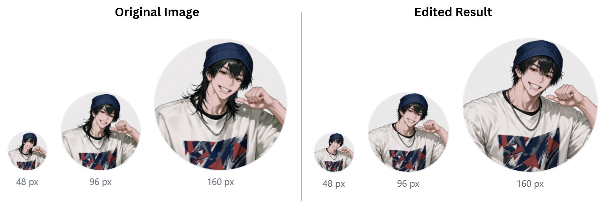 

These edits helped bring the characters closer to the appearance I originally intended without generating them again from scratch.

## Final Profile Picture Checks
Before using an image as an avatar, check the following:

- Crop the image into a circle and preview it at around **48 px**.
- Keep the character's face and important accessories visible.
- Check the image against both light and dark backgrounds.

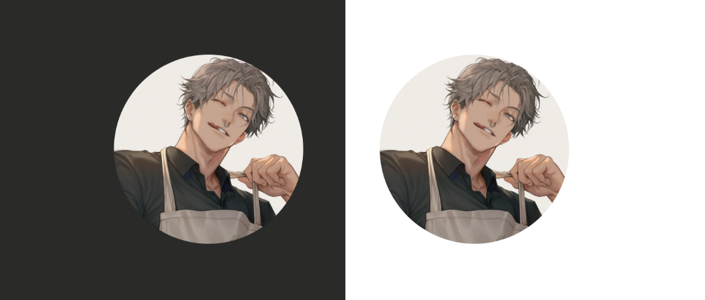 

- Make sure the top of the character's head isn't cut off.

A useful prompt instruction is:

[Leave 20% of the image as space above his head.]

This helps create more balanced framing and leaves room for circular cropping.

## Final Thoughts
Creating **anime boy PFPs** with AI gives you room to experiment with different character concepts without relying on existing anime characters. You can start with a simple description, explore different aesthetics, and refine the results using image editing tools.

Whether you prefer a cool gentleman, a soft pastel character, or a streetwear-inspired OC, the same workflow can help you create a profile picture that matches your own style. You can even [create a matching banner](https://blog.pixai.art/en/ai-outpainting-for-anime-wallpapers-banners/) to go with the PFP with [PixAI](https://pixai.art/?utm_source=eap&utm_medium=social&utm_content=evelyn). 
